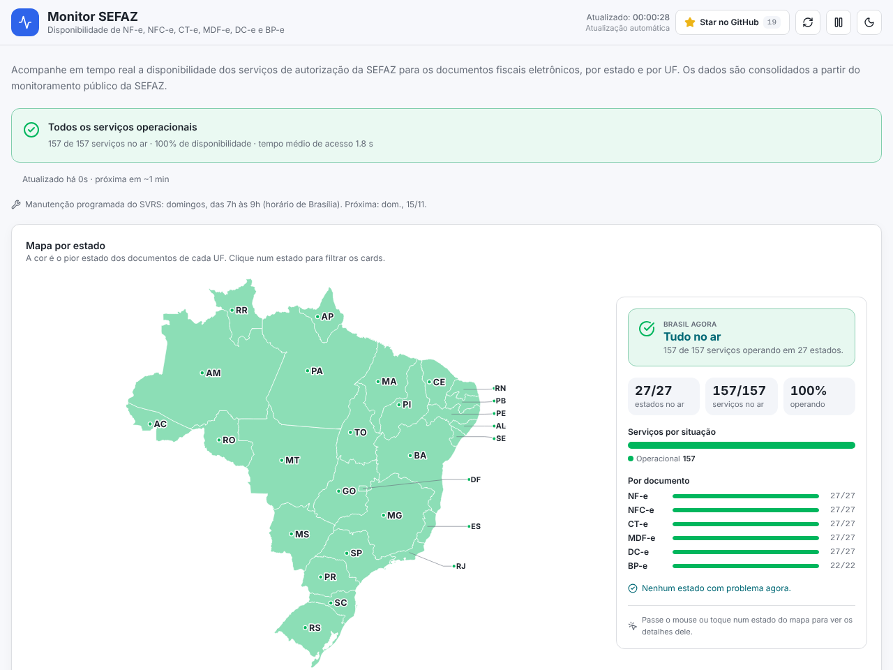

# Monitor SEFAZ

Status page da disponibilidade dos webservices da SEFAZ para os documentos
fiscais eletrônicos brasileiros — **NF-e, NFC-e, CT-e, MDF-e, DC-e, BP-e, NFCom e NF3e, nas 27 UFs**.
Cruza fontes públicas por consenso, mostra o histórico de uptime num dashboard e
avisa quando algo cai. Open-source, independente, sem afiliação com a SEFAZ ou a
Receita Federal.

**→ [Acesse o monitor online](https://felipesauer.github.io/monitor-sefaz/)**

Se o monitor te ajudou, [deixe uma ⭐ no repositório](https://github.com/felipesauer/monitor-sefaz):
é o que faz o projeto aparecer para mais gente.

## Destaques

- **216 serviços monitorados** — os 8 documentos × 27 UFs, resolvendo sozinho qual
  autorizador atende cada estado (próprio, SVRS, SVAN, Ambiente Nacional…).
- **Consenso multi-fonte** — cruza três fontes com precedência para as oficiais, em
  vez de depender de uma só; se uma cai, as outras sustentam.
- **Notificações multicanal** — Discord, Slack, Telegram ou webhook quando um serviço
  cai/volta, entra em contingência, ou sai uma Nota Técnica.
- **Detecção de drift** — sinaliza quando uma fonte oficial fica inconsistente (o
  portal mudou o HTML), em vez de mascarar silenciosamente.
- **Zero-infra por padrão** — roda como site 100% estático no GitHub Pages; sem
  banco, sem servidor, sem certificado.

## O que ele monitora

Os oito documentos fiscais eletrônicos, nas 27 UFs — **216 serviços** no total:

- NF-e — Nota Fiscal Eletrônica (modelo 55)
- NFC-e — Nota Fiscal de Consumidor Eletrônica (modelo 65)
- CT-e — Conhecimento de Transporte Eletrônico
- MDF-e — Manifesto Eletrônico de Documentos Fiscais
- DC-e — Declaração de Conteúdo eletrônica
- BP-e — Bilhete de Passagem Eletrônico (modelo 63)
- NFCom — Nota Fiscal Fatura de Serviços de Comunicação Eletrônica (modelo 62)
- NF3e — Nota Fiscal de Energia Elétrica Eletrônica (modelo 66)

Cada serviço é classificado em um de cinco estados:

| Estado           | Significado                                                         |
| ---------------- | ------------------------------------------------------------------- |
| **Operacional**  | Serviço em operação (cStat 107).                                    |
| **Contingência** | Operando por ambiente de contingência (SVC) — ainda dá para emitir. |
| **Instável**     | Paralisação momentânea / lentidão (cStat 108).                      |
| **Indisponível** | Paralisação sem previsão (cStat 109).                               |
| **Sem dados**    | Não foi possível ler o status naquele momento.                      |

Também acompanha as **Notas Técnicas** publicadas no portal da NF-e, exibidas no
dashboard.

## Status por estado

Cada UF tem uma página com o status ao vivo dos oito documentos, quem autoriza
cada um (a própria SEFAZ, o SVRS ou o SVAN) e o que fazer quando a SEFAZ cai.

<!-- uf-pages:start — gerado de packages/catalog; atualize com `pnpm --filter @monitor-sefaz/web readme` -->

| Norte                                                              | Nordeste                                                                     | Sudeste                                                                 | Sul                                                                        | Centro-Oeste                                                                |
| ------------------------------------------------------------------ | ---------------------------------------------------------------------------- | ----------------------------------------------------------------------- | -------------------------------------------------------------------------- | --------------------------------------------------------------------------- |
| [Acre](https://felipesauer.github.io/monitor-sefaz/sefaz-ac/)      | [Alagoas](https://felipesauer.github.io/monitor-sefaz/sefaz-al/)             | [Espírito Santo](https://felipesauer.github.io/monitor-sefaz/sefaz-es/) | [Paraná](https://felipesauer.github.io/monitor-sefaz/sefaz-pr/)            | [Distrito Federal](https://felipesauer.github.io/monitor-sefaz/sefaz-df/)   |
| [Amapá](https://felipesauer.github.io/monitor-sefaz/sefaz-ap/)     | [Bahia](https://felipesauer.github.io/monitor-sefaz/sefaz-ba/)               | [Minas Gerais](https://felipesauer.github.io/monitor-sefaz/sefaz-mg/)   | [Rio Grande do Sul](https://felipesauer.github.io/monitor-sefaz/sefaz-rs/) | [Goiás](https://felipesauer.github.io/monitor-sefaz/sefaz-go/)              |
| [Amazonas](https://felipesauer.github.io/monitor-sefaz/sefaz-am/)  | [Ceará](https://felipesauer.github.io/monitor-sefaz/sefaz-ce/)               | [Rio de Janeiro](https://felipesauer.github.io/monitor-sefaz/sefaz-rj/) | [Santa Catarina](https://felipesauer.github.io/monitor-sefaz/sefaz-sc/)    | [Mato Grosso](https://felipesauer.github.io/monitor-sefaz/sefaz-mt/)        |
| [Pará](https://felipesauer.github.io/monitor-sefaz/sefaz-pa/)      | [Maranhão](https://felipesauer.github.io/monitor-sefaz/sefaz-ma/)            | [São Paulo](https://felipesauer.github.io/monitor-sefaz/sefaz-sp/)      |                                                                            | [Mato Grosso do Sul](https://felipesauer.github.io/monitor-sefaz/sefaz-ms/) |
| [Rondônia](https://felipesauer.github.io/monitor-sefaz/sefaz-ro/)  | [Paraíba](https://felipesauer.github.io/monitor-sefaz/sefaz-pb/)             |                                                                         |                                                                            |                                                                             |
| [Roraima](https://felipesauer.github.io/monitor-sefaz/sefaz-rr/)   | [Pernambuco](https://felipesauer.github.io/monitor-sefaz/sefaz-pe/)          |                                                                         |                                                                            |                                                                             |
| [Tocantins](https://felipesauer.github.io/monitor-sefaz/sefaz-to/) | [Piauí](https://felipesauer.github.io/monitor-sefaz/sefaz-pi/)               |                                                                         |                                                                            |                                                                             |
|                                                                    | [Rio Grande do Norte](https://felipesauer.github.io/monitor-sefaz/sefaz-rn/) |                                                                         |                                                                            |                                                                             |
|                                                                    | [Sergipe](https://felipesauer.github.io/monitor-sefaz/sefaz-se/)             |                                                                         |                                                                            |                                                                             |

<!-- uf-pages:end -->

## Como obtém os dados

O modo padrão **não exige certificado digital**. O monitor cruza fontes públicas
por consenso, com precedência para as oficiais:

1. **SVRS** — portal de disponibilidade do SVRS (oficial).
2. **Receita** — página de disponibilidade da NF-e/CT-e (oficial).
3. **IntegraNotas** — API pública (não-oficial), mais completa.

As duas fontes oficiais decidem o estado de cada serviço; o IntegraNotas preenche
as UFs e documentos que elas não publicam. MDF-e e DC-e são centralizados no SVRS,
então derivam do estado desse autorizador. O BP-e vem da página de disponibilidade
do BP-e no SVRS, que cobre as 22 UFs autorizadas ali; MG, MS, MT, PR e SP autorizam
o BP-e em ambiente próprio, sem fonte pública, e só aparecem no modo `soap`. Nenhuma
fonte pública mede a latência de rede do BP-e (o SVRS não a publica): o valor fica em
0 e a tela o mostra como "<1 s", sem ser uma medição. A NFCom vem da página do SVRS
para as 24 UFs autorizadas ali; MG, MS e MT autorizam em ambiente próprio, sem
página oficial, e o estado deles vem do IntegraNotas, que publica a NFCom das 27 UFs
(e dá a ela latência de rede medida). O NF3e, como o BP-e, só tem a página do SVRS,
que cobre 23 UFs; MG, MS, MT e PR autorizam em ambiente próprio e só aparecem no
modo `soap`, e a latência dele também fica em 0. Uma fonte que falha não derruba
as demais, e há um **piso de cobertura (75%)** abaixo do qual a coleta é considerada
degradada e não é publicada — evitando exibir "tudo no ar" por engano.

Além do estado por UF, cada coleta publica o **detalhe por serviço** em
`details.json`: as operações de cada autorizador (autorização, consulta, eventos,
status…) como o SVRS e a Receita as publicam, em produção e, para NF-e e CT-e, em
homologação. No CT-e, a Receita mostra ali também a recepção do CT-e OS e da GTV-e,
que não têm consulta de status própria. O detalhe é lido das mesmas páginas que a
coleta já baixa; só as duas páginas de homologação são buscadas a mais.

Cada coleta mede a **cobertura por fonte** e marca quando uma fonte oficial fica
degradada (cobertura abaixo do piso) — o sinal que distingue "a fonte parou de
responder / mudou o HTML" de "o serviço da SEFAZ caiu".

A consulta SOAP direta aos webservices (modo `soap`) fornece dados mais ricos, mas
exige saída de rede e, em vários autorizadores, um certificado A1 (mTLS). É
opcional e desativada por padrão.

## Notificações

Opcionalmente, o monitor alerta quando o estado muda. Cada canal só é ativado
quando suas variáveis de ambiente existem; **sem nenhuma configuração, a
notificação fica desligada** e o pipeline segue idêntico.

Eventos:

| Evento                                       | Quando dispara                                            |
| -------------------------------------------- | --------------------------------------------------------- |
| `SERVICE_DOWN` / `SERVICE_RECOVERED`         | Um serviço saiu / voltou ao ar.                           |
| `CONTINGENCY_ENTERED` / `CONTINGENCY_EXITED` | Entrou / saiu de contingência (SVC).                      |
| `TECHNICAL_NOTE`                             | Nova Nota Técnica publicada no portal.                    |
| `SOURCE_DEGRADED`                            | Uma fonte oficial ficou degradada (drift).                |
| `DAILY_DIGEST`                               | Resumo diário de saúde (opcional, por hora configurável). |

Canais: **Discord**, **Slack**, **Telegram** e **webhook genérico** (recebe o
evento como JSON cru). As variáveis (`NOTIFY_DISCORD_WEBHOOK_URL`,
`NOTIFY_SLACK_WEBHOOK_URL`, `NOTIFY_TELEGRAM_BOT_TOKEN` + `NOTIFY_TELEGRAM_CHAT_ID`,
`NOTIFY_WEBHOOK_URL`, `NOTIFY_EVENTS`, `NOTIFY_DIGEST_HOUR`) estão documentadas em
[`.env.example`](.env.example). Funciona tanto no caminho estático (via GitHub
Actions) quanto no self-host (API).

## Dashboard

- **Uma página por estado** (`/sefaz-sp/`, `/sefaz-mg/`…) com o status ao vivo da UF,
  quem autoriza cada documento, a contingência da NF-e e links para as demais.
- **Mapa do Brasil** clicável, cada UF colorida pelo pior estado agregado.
- **Cards por serviço** com badge de estado, tempo de resposta e _sparkline_ de latência.
- **Histórico de uptime** (24h/72h) com barra estilo status-page e gráfico de latência.
- **Filtros** por documento e por UF; **banner** de saúde geral.
- **Três modos de layout** (Operação, Painel, Painel + métricas) e **tema claro/escuro**.
- **Últimas Notas Técnicas** e um FAQ explicando cStat, autorizadores e contingência.

## API HTTP

No modo self-host, a API expõe (base `/api/v1`):

| Método | Rota                    | Retorna                                                                                         |
| ------ | ----------------------- | ----------------------------------------------------------------------------------------------- |
| GET    | `/health`               | `{ status: 'ok' }`                                                                              |
| GET    | `/status`               | Snapshot atual; filtros `?document=&uf=&env=`                                                   |
| GET    | `/status/:document/:uf` | Status de um serviço específico                                                                 |
| GET    | `/summary`              | Agregado: disponibilidade, no ar, com problema, latência média, por documento e por autorizador |
| GET    | `/services/:id/history` | Série histórica (`?period=24h\|72h`)                                                            |
| GET    | `/services/:id/uptime`  | Uptime %, total de checagens, latência média                                                    |
| GET    | `/incidents`            | Incidentes derivados da série                                                                   |
| GET    | `/stream`               | **SSE** — deltas de mudança de estado em tempo real                                             |

O Cloudflare Worker expõe um subconjunto ao vivo (`/summary`, `/health`, o
snapshot completo e o histórico acumulado em `/history` e
`/services/:id/history`). A antiga rota `/collect` responde 410: a gravação do
histórico saiu do Worker.

## Cadência da coleta

O status exibido é sempre **ao vivo** — cada carregamento consulta as fontes na
hora. O que precisa ser acumulado é o **histórico**. Ele é coletado no GitHub
Actions a cada 5 minutos e guardado em dois lugares:

| Onde                            | Retenção       | Papel                              |
| ------------------------------- | -------------- | ---------------------------------- |
| **Workers KV** (via `/history`) | 72h            | Fonte primária do histórico na SPA |
| **JSONs no Pages**              | 7 dias ou 2 MB | Reserva, e o modo sem infra        |

Quem marca o ritmo é o Cron Trigger do Worker: a cada 5 minutos ele só dispara o
`collect.yml` pela API do GitHub. A coleta em si não roda no Worker, porque no
plano Workers Free cada execução agendada tem 10 ms de CPU e uma rodada gasta
~160 ms; medido em 72h, 55% das execuções eram cortadas e o histórico ficava com
buracos de horas. O cron do próprio Actions (`collect-schedule.yml`, de hora em
hora, que na prática entrega uma execução a cada ~5h) fica como rede de
segurança.

Os JSONs não são commitados: cada coleta os publica direto no Pages e passa o
estado para a seguinte pelo cache do Actions.

O histórico do KV é guardado num **formato compacto** (`packages/contracts`):
o estado vira _run-length_ (segmento novo só quando muda) e a latência é agregada
por hora. Isso mantém 72h × 216 serviços em ~260 KB numa única chave de KV — 288
escritas/dia, dentro do free tier — em vez dos megabytes que um ponto por
checagem exigiria. A SPA expande de volta para pontos, na resolução que cada
componente precisa.

## Uso

A forma mais simples é acessar o site publicado.

Para rodar localmente é necessário Node 22.12+ e pnpm.

    pnpm install

    # Gera os arquivos de status consultando as fontes públicas
    pnpm --filter @monitor-sefaz/collector collect ./apps/web/public/data

    # Sobe o dashboard em http://localhost:5173
    pnpm --filter @monitor-sefaz/web dev

## Deploy

O mesmo motor de coleta alimenta três formas de rodar:

**SPA estática (GitHub Pages).** Um GitHub Actions coleta e versiona os JSONs; a SPA
apenas os lê. Não requer infraestrutura. O build pré-renderiza a home e as 27
páginas por UF: o conteúdo chega no HTML, pronto para buscadores, e o status ao
vivo vem depois, por fetch.

**Cloudflare Worker.** O Worker serve o status ao vivo com CORS e o histórico do
Workers KV, e seu Cron Trigger dispara a coleta do Actions a cada 5 minutos. O
despacho usa um token fine-grained do GitHub (só este repositório, Actions: read
and write), guardado como secret:

    pnpm --filter @monitor-sefaz/worker exec wrangler secret put GITHUB_DISPATCH_TOKEN

A coleta grava o KV pela API REST do Cloudflare com o secret de repositório
`CLOUDFLARE_KV_TOKEN` (Workers KV Storage: Edit) e a variável
`CLOUDFLARE_ACCOUNT_ID`.

    # Deploy (requer wrangler login)
    pnpm --filter @monitor-sefaz/worker deploy

O id do namespace de KV em [`apps/worker/wrangler.toml`](apps/worker/wrangler.toml)
aponta para a conta do deploy oficial. Num fork, crie o seu e substitua:

    pnpm --filter @monitor-sefaz/worker exec wrangler kv namespace create HISTORY

Sem o binding `HISTORY` o Worker continua funcionando, apenas sem acumular
histórico: `/history` responde 501 e a SPA cai no JSON estático.

**Self-host.** API Fastify com Redis, scheduler e SSE, servindo o dashboard. É o
único modo com histórico persistido, tempo real e suporte ao modo SOAP+A1.

    docker compose up --build   # http://localhost:3333

## Configuração

O front escolhe a fonte de dados por variável de ambiente: com `VITE_API_BASE_URL`
definida consome a API/Worker ao vivo; vazia, lê os JSONs estáticos.

O build do site pré-renderiza a home e as páginas por UF, e lê mais três
variáveis:

- `SITE_URL`: URL pública absoluta, usada no canonical, no Open Graph e no
  sitemap. O padrão é o deploy oficial.
- `GOOGLE_SITE_VERIFICATION` / `BING_SITE_VERIFICATION`: códigos de
  verificação do Google Search Console e do Bing Webmaster Tools. Viram as
  meta tags `google-site-verification` e `msvalidate.01` em todas as páginas.
  Aceitam o código puro ou a `<meta>` inteira, como o painel a mostra. No
  Google, o nome do arquivo do método "Arquivo HTML" (`google….html`) também
  serve: o build grava o arquivo na raiz do site. No deploy oficial, vêm de um
  secret, de uma variável do repositório ou da environment `github-pages`.

A API self-host lê as variáveis de um `.env` na raiz (veja [`.env.example`](.env.example)):

- `STATUS_SOURCE` — `hybrid` (consenso multi-fonte, padrão), `availability` (só a
  página oficial) ou `soap` (consulta SOAP direta)
- `REDIS_URL` — conexão com o Redis
- `SEFAZ_CERT_PATH` / `SEFAZ_CERT_PASSPHRASE` — certificado A1 (.pfx) para o modo `soap`
- `CRON_EXPRESSION`, `SEFAZ_TIMEOUT_MS`, `SEFAZ_CONCURRENCY`, `HISTORY_RETENTION_MS`, `RATE_LIMIT_MAX`
- `NOTIFY_*` — canais de notificação (ver seção acima)

Homologação não aparece: a página pública da SEFAZ cobre apenas produção, e o
ambiente de homologação só é alcançável pelo modo `soap`.

## Arquitetura

Monorepo TypeScript (strict) gerenciado com pnpm e Turborepo.

    packages/catalog     UFs, cStat, endpoints e o mapa UF -> autorizador
    packages/core        motor de coleta: consenso multi-fonte, SOAP e notas técnicas
    packages/contracts   schemas Zod e DTOs compartilhados
    packages/notifier    detecção de transições e canais de notificação
    apps/collector       CLI que gera os JSONs publicados no Pages (GitHub Actions)
    apps/worker          Cloudflare Worker: status ao vivo, histórico do KV e despacho da coleta
    apps/api             API Fastify self-host: scheduler, REST, SSE e Redis
    apps/web             dashboard React + Vite

Os três caminhos (collector, worker e API) usam o **mesmo** motor de consenso e o
**mesmo** piso de cobertura, para os números baterem entre as pontas.

### Pacotes no npm

Os quatro pacotes de `packages/` são publicados sob o escopo
[`@monitor-sefaz`](https://www.npmjs.com/org/monitor-sefaz) e podem ser usados
fora do projeto:

| Pacote                                           | Serve para                                                                            |
| ------------------------------------------------ | ------------------------------------------------------------------------------------- |
| [`@monitor-sefaz/catalog`](packages/catalog)     | Mapa UF → autorizador, endpoints dos webservices e tabela de cStat. Sem dependências. |
| [`@monitor-sefaz/core`](packages/core)           | Motor de coleta: consenso multi-fonte, parsers dos portais e consulta SOAP.           |
| [`@monitor-sefaz/contracts`](packages/contracts) | Schemas Zod e DTOs — úteis para validar as respostas da API pública.                  |
| [`@monitor-sefaz/notifier`](packages/notifier)   | Detecção de transições e canais de notificação.                                       |

    npm i @monitor-sefaz/catalog

O versionamento usa [changesets](.changeset/README.md); a publicação é feita
pelo workflow `release.yml`, com _provenance_ via OIDC. Os apps não são
publicados.

Comandos, a partir da raiz:

    pnpm build        builda todos os pacotes e apps
    pnpm dev          sobe os apps em modo desenvolvimento
    pnpm test         roda os testes (Vitest)
    pnpm typecheck    checagem de tipos
    pnpm lint         ESLint

São **308 testes** (Vitest), com as respostas da SEFAZ mockadas por fixtures em
`packages/core/test` — os testes nunca dependem da rede. O CI roda lint, typecheck
e testes em cada pull request; um workflow separado e não-bloqueante faz uma coleta
ao vivo periódica e alerta se uma fonte oficial degradar, capturando o drift do
portal que as fixtures estáticas não pegam.

## Referências

Portais oficiais de disponibilidade e fontes que o monitor consome:

- [Portal Nacional da NF-e — Disponibilidade](https://www.nfe.fazenda.gov.br/portal/disponibilidade.aspx)
- [Portal Nacional do CT-e — Disponibilidade](https://www.cte.fazenda.gov.br/portal/disponibilidade.aspx)
- [Portal de Documentos Fiscais Eletrônicos do SVRS](https://dfe-portal.svrs.rs.gov.br)
- [IntegraNotas — Monitor SEFAZ](https://integranotas.com.br/doc/sefaz/monitor)

## Contribuindo

Contribuições são bem-vindas. O fluxo de desenvolvimento, os padrões de código e o
passo a passo para adicionar um documento ou autorizador estão em
[CONTRIBUTING.md](CONTRIBUTING.md). Para relatar uma falha de segurança, veja
[SECURITY.md](SECURITY.md).

## Licença

[MIT](LICENSE) © Felipe Sauer
